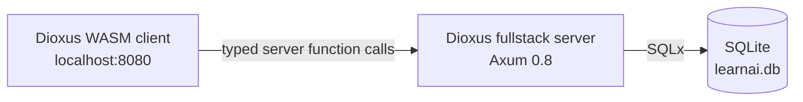
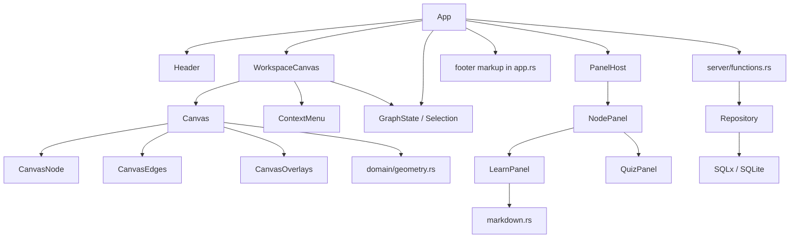

# learn.ai — Rust System Map

This map covers every hand-written Rust file, component, hook-equivalent, server
function, and supporting build file. It replaces the previous React/Python map.

Generated or local-only paths are excluded: `target/`, `dist/`, `learnai.db`,
`more todo.md`, and Cargo/npm caches. `docs/mindmap.schema.json` is generated by
`src/bin/export_schema.rs`; `examples/mindmap.json` is hand-written.

## 1. Runtime topology



`src/main.rs` launches the client in a WASM build and starts the Axum/Dioxus
server when compiled with the `server` feature. Dioxus registers the server
functions and serves `target/release/public` (the client assets) at the same
origin.

## 2. Data flow

### Load

1. `app::App` mounts and `use_future` calls `load_initial`.
2. `load_initial` calls `list_mindmaps`, then `get_mindmap` or `create_mindmap`.
3. `apply_resource` copies the document into `Signal<GraphState>`, title,
   current ID, maps list, and the last-saved snapshot.
4. The selected map ID is stored in browser localStorage through
   `platform::remember_id`.

### Edit and autosave

1. Canvas/panel events mutate `Signal<GraphState>` or `Signal<Selection>`.
2. `app::App` builds a `MindmapDocument` with `GraphState::document`.
3. `use_effect` compares its serialized JSON with `last_saved`.
4. After 800 ms (`platform::sleep_ms`), the latest snapshot calls
   `save_mindmap`.
5. Success updates `save_status`, `last_saved`, and the picker summary; failure
   sets `save_error` and enables retry.

### Server

1. Dioxus server function macro deserializes named arguments.
2. `server/functions.rs` normalizes the title and calls `validate_document`.
3. `server/repository.rs` reads/writes the `mindmaps` row.
4. `server/db.rs` lazily creates the pool and runs SQLx migrations.
5. `server/error.rs` maps failures to `ApiError` status codes.

## 3. File and function reference

### Entry and composition

| File | Function | Responsibility | Uses |
| --- | --- | --- | --- |
| `src/main.rs` | `main` | Launch client or fullstack server; register health routes | `app::App`, `dioxus::serve/launch` |
| | `health` | `/health` and `/api/health` | Axum route |
| `src/app.rs` | `document_json` | Serialize a document for dirty comparison | `serde_json` |
| `src/app_actions.rs` | `apply_resource`, `load_initial` | Hydrate signals / load the map library | server functions, platform |
| | `title_change_handler`, `open_map_handler`, `new_map_handler`, `delete_map_handler`, `retry_save_handler` | Map/library actions | signals, server functions |
| | `PanelHost` | Connect panel callbacks to graph signals | NodePanel |
| `src/app.rs` | `App` | State owner, load/save orchestration, layout | all components, server functions |
| `src/platform.rs` | `remembered_id`, `remember_id` | localStorage on web; no-op on server | gloo-storage |
| | `confirm` | Delete confirmation on web; true on server | web-sys |
| | `viewport_size` | Browser dimensions for clamping context menus | web-sys |
| | `sleep_ms` | 800 ms debounce timer; feature-specific implementation | gloo-timers / tokio |

### Domain

| File | Function/type | Responsibility |
| --- | --- | --- |
| `domain/document.rs` | `Side`, `NoteStatus` | JSON enums and status colors |
| | `QuizQuestion`, `LearnContent`, `QuizContent` | Learn/Quiz nested content |
| | `MindmapNode`, `MindmapLink`, `MindmapDocument` | persisted document model |
| | `MindmapResource`, `MindmapSummary` | server response shapes |
| `domain/geometry.rs` | `Point`, `RenderedEdge`, `EdgeEnd` | canvas geometry values |
| | `side_point`, `local_handle_point` | anchor coordinates |
| | `hit_test_node`, `side_toward_point`, `side_from_vector` | pointer/target hit testing |
| | `find_connect_candidate`, `connect_target` | 36px anchor snapping and connect rules |
| | `edge_exists_between`, `edge_target` | rewire/connect duplicates, same-pair side changes |
| | `opposite_side` | connect-to-empty target side |
| | `curve_path`, `render_edge`, `render_edges` | cubic SVG paths |
| | `distance`, `nodes_in_rect` | drag threshold and marquee hits |
| `domain/quiz.rs` | `new_id`, `new_question`, `new_node` | stable IDs and defaults |
| | `measure_node_width` | approximate label width |
| | `next_node_number` | continue Node N numbering (tested; future use) |
| | `update_option`, `add_option`, `delete_option`, `finalize_question` | pure MCQ edits and blank-choice cleanup |
| `domain/validation.rs` | `normalize_title` | blank title fallback |
| | `validate_document` | document limits + graph rules |
| | `validate_nodes`, `validate_quiz`, `validate_links` | focused validators |
| `domain/schema.rs` | `build_schema`, `render_schema` | schemars JSON Schema |
| `domain/tests.rs` | eight tests | validation, geometry, edge/connect targets, quiz, schema |

### Server

| File | Function | Responsibility |
| --- | --- | --- |
| `server/db.rs` | `db` | lazy `SqlitePool`, create DB, run migrations |
| `server/repository.rs` | `StoredDocument`, `MindmapRow` | row/JSON mapping |
| | `now`, `new_mindmap_id`, `to_resource`, `to_summary` | metadata helpers |
| | `list`, `get`, `create`, `replace`, `delete` | CRUD |
| `server/functions.rs` | `prepare` | normalize + validate |
| | `list_mindmaps`, `get_mindmap`, `create_mindmap`, `save_mindmap`, `delete_mindmap` | typed Dioxus server functions |
| `server/error.rs` | `ApiError` | serializable error + `AsStatusCode` mapping |

### UI state

| File | Type/function | Responsibility |
| --- | --- | --- |
| `state/graph.rs` | `GraphState` | nodes/links; document conversion |
| | `from_resource` | load a saved map into graph state |
| | `document` | graph → JSON document |
| | `next_label`, `add_node_at` | node creation |
| | `remove_node` | remove node + incident links |
| | `rename_node`, `set_blocks`, `set_questions`, `set_status` | node edits |
| | `move_nodes` | group drag updates |
| | `add_link`, `rewire_link`, `remove_link` | link edits and endpoint rewiring |
| `state/selection.rs` | `Selection` | node/edge/panel selection |
| | `clear`, `select_node`, `focus_node`, `select_edge`, `select_marquee`, `close_panel` | selection transitions |
| | `single_node` | panel eligibility |
| `state/mod.rs` | re-exports | public state API |

### Components

| File | Component | Responsibility | Calls |
| --- | --- | --- | --- |
| `components/header.rs` | `Header` | title, picker, save status, new/delete | app callbacks |
| `components/workspace_canvas.rs` | `WorkspaceCanvas` | canvas/state wiring, context-menu host | Canvas, ContextMenu, state |
| `components/canvas.rs` | `Canvas` | SVG grid, drag/connect/rewire/marquee coordinator | CanvasNode, CanvasEdges, CanvasOverlays |
| `components/canvas_node.rs` | `CanvasNode` | node shape, fading side handles, drag/context events | geometry |
| `components/canvas_edges.rs` | `CanvasEdges` | edge strokes, hit paths, rewire handles | geometry |
| `components/canvas_overlays.rs` | `CanvasOverlays` | connect/edge previews, ghost node, marquee box | geometry |
| `components/canvas_types.rs` | interaction types | outcomes/state/pointer conversion | geometry |
| `components/context_menu.rs` | `ContextMenu` | fixed-position node/edge delete menu | platform viewport size |
| `components/panel.rs` | `NodePanel` | title/status/tabs and panel actions | LearnPanel, QuizPanel |
| `components/learn.rs` | `LearnPanel` | block add/edit/delete/preview | markdown renderer |
| `components/markdown.rs` | `render_markdown`, `extract_math`, `render_math` | safe markdown + KaTeX HTML | pulldown-cmark, ammonia, katex-rs |
| `components/quiz.rs` | `QuizPanel` | MCQ editor, Done/finalize flow, practice feedback | quiz helpers |
| `components/workspace_footer.rs` | `WorkspaceFooter` | selection/delete footer | app callbacks |
| `components/mod.rs` | module exports | component surface | — |

### Build and support

| File | Responsibility |
| --- | --- |
| `Cargo.toml` | dependencies, web/server features, release profile, two bins |
| `Cargo.lock` | reproducible dependency graph |
| `rust-toolchain.toml` | Rust 1.100 + wasm target |
| `migrations/0001_init.sql` | mindmaps table |
| `migrations/0002_normalize_timestamps.sql` | Python-era timestamps → RFC 3339 |
| `assets/index.html` | client HTML shell, hydration shim, fonts, stylesheet links |
| `assets/styles/base.css` | tokens, reset, shell, overlays, shared buttons |
| `assets/styles/header.css` | header, map picker, save state, footer |
| `assets/styles/workspace.css` | canvas, node panel, tabs, context menu |
| `assets/styles/content.css` | Learn blocks, Quiz editor/practice |
| `assets/styles/markdown.css` | rendered markdown typography and code styles |
| `assets/favicon.svg` | static icon |
| `scripts/build.sh` | copy CSS → WASM → wasm-bindgen → server → public assets |
| `scripts/dev.sh` | build and run server |
| `scripts/check.sh` | fmt, clippy, tests |
| `examples/mindmap.json` | hand-written document example |
| `docs/mindmap.schema.json` | generated schema |
| `.env.example` | database URL example |
| `.devcontainer/*` | Rust/WASM development container |
| `.dockerignore`, `.gitignore` | build/data exclusions |
| `README.md`, `AGENTS.md`, this map | documentation |

## 4. Component wiring



## 5. Verification

```bash
./scripts/check.sh
```

Manual fullstack verification performed with headless Chromium:

- `/` returns SSR HTML with hydration data
- WASM client hydrates
- “Create first node” updates the canvas, opens the node panel
- autosave sends the new node document to SQLx
- `/health` and `/api/health` return 200
