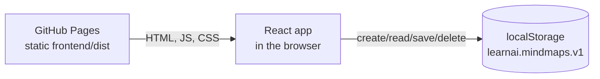

# learn.ai — System Map

This map covers the static React/TypeScript application and the GitHub Pages
build. The app has no backend, API routes, or server process.

## 1. Runtime topology



Vite builds a static bundle with relative asset URLs. GitHub Actions uploads
`frontend/dist` as the Pages artifact; the browser persists maps locally.

## 2. Data flow

### Load

1. `main.tsx` mounts `App` inside React StrictMode.
2. `MindmapPage` creates graph/selection/interaction hooks.
3. `useMindmapSync` calls `listMindmaps` from `storage/mindmaps.ts`.
4. It loads the remembered map (or the most recently updated map), falling back
   to `createMindmap(emptyMindmap())` when the library is empty.
5. `fromMindmapDocument` converts the stored JSON shape into UI `Node`, `Link`,
   and `TextBox` objects and the reducer replaces graph state.

### Edit and autosave

1. Canvas and panel events dispatch reducer actions or change selection state.
2. `useMindmapSync` serializes title/nodes/links/texts through
   `toMindmapDocument`.
3. `useMindmapAutosave` debounces changes for 800 ms and calls
   `saveMindmap`.
4. localStorage writes are synchronous; success updates the save indicator and
   map picker summary. Errors surface in the header with a retry action.
5. `pagehide` performs one final save for edits made during the debounce window.

### Storage

- All maps are one JSON record under `learnai.mindmaps.v1`.
- Each resource includes `id`, `createdAt`, and `updatedAt` metadata generated
  in the browser.
- The last opened map ID lives under `learnai.lastMindmapId`.
- Data is scoped to the deployed origin; there is no synchronization.

## 3. Entry and composition

| File | Responsibility |
| --- | --- |
| `frontend/index.html` | Vite HTML shell, fonts, `%BASE_URL%` favicon |
| `frontend/src/main.tsx` | React root and `index.css` import |
| `frontend/src/App.tsx` | Renders `MindmapPage` |
| `frontend/src/components/MindmapPage.tsx` | Composes header/canvas/panel/footer, map actions, selection cleanup |
| `frontend/src/components/MindmapHeader.tsx` | Title, map picker, save status, new/delete |
| `frontend/src/components/MindmapFooter.tsx` | Selection, counts, and canvas hints |
| `frontend/src/components/CanvasStatusOverlay.tsx` | Loading/error/empty states |
| `frontend/src/components/CanvasZoomControls.tsx` | Bottom-left zoom percentage and +/- controls |
| `frontend/src/components/NodePanel.tsx` | Animated node title panel, status group, Learn/Quiz tabs |
| `frontend/src/components/LearnTab.tsx` | Markdown block list/editor |
| `frontend/src/components/MarkdownBlock.tsx` | Source editor, preview, Done/Ctrl+Enter |
| `frontend/src/components/NodeQuiz.tsx` | Quiz question list and practice answers |
| `frontend/src/components/QuizQuestionBlock.tsx` | MCQ editor, Done, blank-choice cleanup |
| `frontend/src/components/MarkdownPreview.tsx` | Safe rendered markdown |
| `frontend/src/components/Latex.tsx` | KaTeX span rendering |
| `frontend/src/components/ContextMenu.tsx` | Shared canvas/node/edge/text menu |
| `frontend/src/components/CanvasTextBox.tsx` | Draggable, transparent text annotations |
| `frontend/src/components/InlineEdgeEditor.tsx` | Edge-label editor anchored to the curve midpoint |
| `frontend/src/components/InlineNodeEditor.tsx` | Inline canvas title editor |
| `frontend/src/components/buttonStyles.ts` | Shared button class strings |
| `frontend/src/components/DeleteButton.tsx`, `PlusIcon.tsx`, `TrashIcon.tsx` | Shared icons/actions |

### Canvas components

| File | Responsibility |
| --- | --- |
| `MindmapCanvas.tsx` | SVG surface, pan/zoom transform, grid, text boxes, edge arrows, node/edge previews |
| `MindmapNode.tsx` | Node rectangle, status colors, anchors, fading handles |
| `EdgePaths.tsx`, `EdgeStroke.tsx` | Dashed edges, transparent masked labels, arrow markers, and hit paths |
| `EdgeHandles.tsx` | Endpoint rewire handles |
| `EdgePreview.tsx` | Ghost node and connection/edge previews |

## 4. State and interaction modules

| File | Responsibility |
| --- | --- |
| `frontend/src/graph.ts` | `Node`/`Link`/`Side` types, anchors, curves, width measurement |
| `frontend/src/interaction.ts` | Hit testing, anchor snapping, connect/edge target resolution, marquee rules |
| `frontend/src/previews.ts` | Ghost node, connect preview, edge-drag preview |
| `frontend/src/quiz.ts` | MCQ create/update/add/delete plus `finalizeQuestion` |
| `frontend/src/status.ts` | Status labels/colors |
| `frontend/src/markdown.tsx` | Markdown parsing, sanitizing, math rendering |
| `frontend/src/canvasPoint.ts` | Client coordinates -> SVG coordinates |
| `frontend/src/selectionBounds.ts` | Bounds outline for selected items |
| `frontend/src/panelViewport.ts` | Left-half centering target and panel viewport restore |
| `frontend/src/contextMenus.ts` | Builds context menus for canvas, node, edge, and text targets |
| `frontend/src/state/mindmapReducer.ts` | Pure node/link/text add/move/update/remove transitions |
| `frontend/src/persistence.ts` | UI model <-> portable JSON document |
| `frontend/src/storage/mindmaps.ts` | localStorage CRUD repository |
| `frontend/src/storage/types.ts` | Stored document/resource/summary, edge metadata, and text-box types |
| `frontend/src/mindmapLibrary.ts` | Last-opened-map localStorage helpers |
| `frontend/src/errors.ts` | Safe error message extraction |

### Hooks

| Hook | Responsibility |
| --- | --- |
| `useMindmapGraph` | Reducer state, stable ID lookup, graph mutations |
| `useMindmapSync` | Library load, map switching/creating/deleting, storage flush |
| `useMindmapAutosave` | Debounce, save queue, status/retry, page-hide flush |
| `useMindmapSelection` | Node/edge/text/panel selection |
| `useMindmapInteractions` | Coordinates the interaction hooks, space/middle-drag panning |
| `useCanvasAnnotations` | Text-box and edge-label editing state |
| `useTextDrag` | Free-standing text annotation dragging |
| `useMindmapMenus` | Right-click handlers and menu item wiring |
| `useCanvasViewport` | Pan offset, zoom clamping/anchoring, wheel gestures, world conversion |
| `useNodeDrag` | Move one or many selected nodes |
| `useConnectDrag` | Drag from a side handle to create an edge/ghost node |
| `useEdgeDrag` | Rewire an existing edge endpoint |
| `useEdgeHover` | Hover state and delayed handle hiding |
| `useMarqueeSelection` | Box selection for nodes, edges, and text boxes |
| `useLabelEditing` | Inline node-name editing |
| `useMindmapContextMenu` | Shared context-menu open/close state |
| `useCanvasSize` | ResizeObserver-based canvas dimensions |

## 5. Storage API

`frontend/src/storage/mindmaps.ts` exposes:

| Function | Behavior |
| --- | --- |
| `listMindmaps` | Most recently updated summaries first |
| `createMindmap` | New `mm_...` ID, timestamps, cloned document |
| `getMindmap` | Full resource or 404-style storage error |
| `saveMindmap` | Replaces document, preserves `createdAt`, updates `updatedAt` |
| `deleteMindmap` | Removes the map record |

The async signatures keep the sync/autosave hooks straightforward and make a
future IndexedDB implementation possible without touching components.

## 6. Build and deployment

| File | Responsibility |
| --- | --- |
| `frontend/package.json` | React/Vite/Tailwind/Vitest scripts and dependencies |
| `frontend/vite.config.ts` | React plugin, dev port, relative production base |
| `frontend/tailwind.config.js`, `postcss.config.js` | Tailwind theme and pipeline |
| `frontend/tsconfig*.json` | TypeScript app/node/test configuration |
| `frontend/vitest.config.ts`, `src/test/setup.ts` | jsdom test environment |
| `frontend/public/.nojekyll` | Prevent Jekyll processing on Pages |
| `.github/workflows/deploy-pages.yml` | Install, test, typecheck/build, upload/deploy Pages |
| `scripts/dev.sh` | Installs dependencies if needed and runs Vite |
| `docs/mindmap.schema.json` | JSON Schema for the portable document |
| `examples/mindmap.json` | Hand-written document example |

## 7. Verification

```bash
npm --prefix frontend test
npm --prefix frontend run typecheck
npm --prefix frontend run lint
npm --prefix frontend run build
```

The production build was also checked from a nested static path
(`/learn-ai/`) with a headless browser:

- page load and hydration
- first-node creation and node dragging after zooming
- zoom HUD percentage changes from the +/- buttons and Ctrl/Cmd+wheel
- wheel panning and Space-drag panning
- opening the panel centers the selected node in the left half
- closing the panel restores the previous viewport when the canvas was not
  manually panned or zoomed during preview
- Escape closes the panel from the canvas or an active editor
- marquee selection includes text boxes and Delete removes them
- blank-canvas right-click adds nodes or draggable text boxes
- edge right-click or double-click edits labels; the Arrow submenu switches directions
- viewport reset when switching maps
- navigation reload with the node restored from localStorage
- no `/api` requests
- no console or page errors
