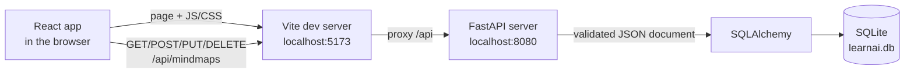
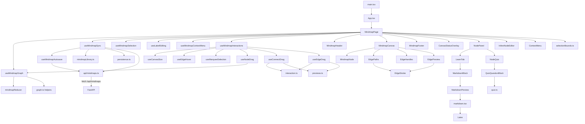
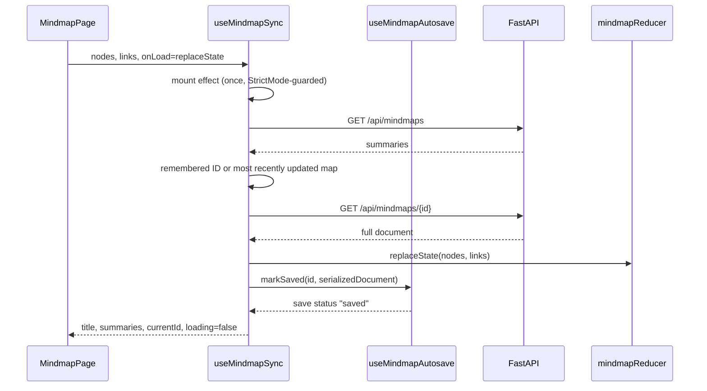
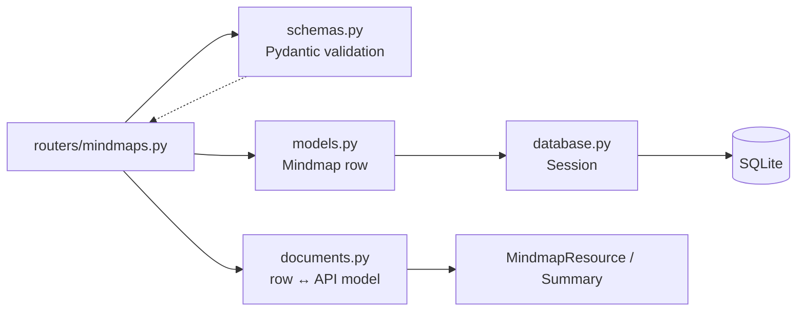

# learn.ai — System Map

This document answers three questions for every hand-written part of the
codebase:

1. **What is this file/function responsible for?**
2. **Who calls it?**
3. **What does it call?**

It is written for someone who knows Python but is new to TypeScript, React, and
web applications. Read the [glossary](#17-glossary) first if terms like
"component", "hook", or "HTTP endpoint" are unfamiliar.

---

## 1. Scope

### Included

- Every hand-written frontend source file, test, config, and static entry point
- Every hand-written backend Python file, test, example, and requirement file
- Shell scripts, dev-container files, environment examples, and docs

### Excluded as generated or user-local

| Path | Why it is excluded |
| --- | --- |
| `frontend/dist/` | Vite production build output |
| `frontend/coverage/` | Generated coverage report |
| `frontend/node_modules/` | Installed npm dependencies |
| `frontend/package-lock.json` | Generated npm lockfile (gitignored) |
| `.venv/` | Installed Python environment |
| `**/__pycache__/`, `.pytest_cache/`, `.ruff_cache/` | Python tool caches |
| `learnai.db` | Runtime SQLite database |
| `docs/mindmap.schema.json` | Generated from `backend/app/schema_export.py` |
| `more todo.md` | Personal scratch note, not part of the app |
| `.git/` | Version-control internals |

`backend/examples/mindmap.json` is **not** generated; it is a hand-written
contract example and is included.

---

## 2. System at a glance



In development the browser only talks to port **5173**. Vite serves the React
app and proxies `/api/*` to FastAPI on port **8080**. FastAPI validates the
document with Pydantic, converts it with `documents.py`, and stores it through
SQLAlchemy in one SQLite row per map.

### Three cooperating planes

| Plane | Main files | Responsibility |
| --- | --- | --- |
| **Rendering** | `App.tsx`, `MindmapPage.tsx`, `components/*` | Turn state into SVG and DOM; report user actions |
| **Interaction** | `useMindmapInteractions`, `useNodeDrag`, `useConnectDrag`, `useEdgeDrag`, `useMarqueeSelection` | Translate pointer events into graph mutations |
| **Persistence** | `useMindmapSync`, `useMindmapAutosave`, `api/mindmaps.ts`, `persistence.ts`, backend | Load, serialize, validate, and save maps |

---

## 3. Frontend call graph



### Dependency rules

- **Pure modules** (`graph.ts`, `interaction.ts`, `previews.ts`, `canvasPoint.ts`,
  `selectionBounds.ts`, `persistence.ts`, `quiz.ts`) do not import React,
  components, or hooks. They are easy to unit test.
- **Hooks** may import pure modules and the API layer, but not components.
- **Presentational components** receive data and callbacks through props. The
  main exception is `MindmapPage`, which is the composition root that owns
  hooks and passes their output down.
- **API modules** know HTTP and JSON types only; they do not know React.
- The one type-only cross-import is `graph.ts` ← `quiz.ts` (`QuizQuestion`)
  while `quiz.ts` imports `uid` from `graph.ts`. TypeScript erases the type
  import, so there is no runtime cycle.

---

## 4. Runtime flows

### 4.1 Startup and map loading



If the list is empty, `useMindmapSync` POSTs an empty “Untitled mindmap”
instead. If the list request fails, it shows an error instead of creating a
duplicate map.

### 4.2 Autosave

1. A graph edit changes `nodes`/`links`, or a title edit changes `title`.
2. `useMindmapSync` builds a `MindmapDocument` with `toMindmapDocument`.
3. `useMindmapAutosave` compares its JSON string with the last saved snapshot.
4. If different, it waits **800 ms** (debounce). Further edits restart the timer.
5. It sends `PUT /api/mindmaps/{id}` with the full document.
6. FastAPI validates the body and replaces the stored JSON.
7. `onSaved` updates the map-picker summary; the header shows **Saved**.
8. Saving is serialized by a promise chain, so two PUTs never overlap.
9. `pagehide` performs a best-effort keepalive PUT when the tab closes.

### 4.3 Canvas interactions

| Gesture | Hook | Result |
| --- | --- | --- |
| Drag a node/group | `useNodeDrag` | `moveNodes` with one shared pointer delta |
| Drag a side handle to another node | `useConnectDrag` | `addLink` |
| Drag a side handle to empty canvas | `useConnectDrag` | `addNode` + `addLink` + focus |
| Drag an edge endpoint to another node | `useEdgeDrag` | `updateLink` |
| Drag an edge endpoint to empty canvas | `useEdgeDrag` | `removeLink` |
| Drag empty canvas | `useMarqueeSelection` | `selectMarquee` |
| Hover a node | `useMindmapInteractions` | show four anchors/handles |
| Hover an edge | `useEdgeHover` + `EdgeHandles` | show endpoint handles |

### 4.4 Learn and Quiz edits

- **Learn:** `NodePanel` → `LearnTab` → `MarkdownBlock`; editing calls
  `MindmapPage` → `graph.setNodeBlocks` → reducer `set-blocks`.
- **Quiz:** `NodePanel` → `NodeQuiz` → `QuizQuestionBlock`; editing calls
  `MindmapPage` → `graph.setNodeQuestions` → reducer `set-questions`.
- Both paths update graph state. The sync hook sees the change and autosaves it.
- Markdown is stored as plain strings; rendering is handled by `markdown.tsx`
  and `Latex.tsx`, not by the backend.

### 4.5 Map switching and deletion

- **Switch:** `useMindmapSync.openMap` flushes the current map, GETs the new
  one, calls `replaceState`, and `MindmapPage` clears stale selection when
  `currentId` changes.
- **New map:** flush current map → POST empty map → load it.
- **Delete:** DELETE the row; if it was current, load the next map or create an
  empty one. A pending debounce timer is cancelled first.
- **Delete node/edge:** `useMindmapContextMenu` dispatches to
  `deleteNodeById`/`deleteEdgeById`; the reducer also removes incident links.

### 4.6 Backend request path



---

## 5. Complete frontend file and function reference

### 5.1 Entry and shell

| File | Function / export | Responsibility | Calls / used by |
| --- | --- | --- | --- |
| `src/main.tsx` | bootstrap code | Create the React root and render `<App/>` in StrictMode | `App.tsx`, `index.css` |
| `src/App.tsx` | `App` | One-line application shell | `MindmapPage` |
| `src/index.css` | — | Tailwind layers, root colors, full-height layout, font defaults | imported by `main.tsx` |
| `index.html` | — | HTML shell, fonts, favicon, root node | Vite build |
| `public/favicon.svg` | — | Static site icon | `index.html` |

### 5.2 Domain and pure helpers

#### `src/graph.ts`

Defines the graph data model, node geometry, and edge curves.

| Function/export | What it does | Used by |
| --- | --- | --- |
| types `Node`, `Link`, `Side`, `Point`, `RenderedEdge` | Shared domain shapes | Almost every module |
| constants `NODE_W`, `NODE_H`, `HANDLE_R`, `HANDLE_HIT_R`, `SIDES` | Canvas geometry | Nodes, edges, interaction hooks, tests |
| `getMeasureContext` (internal) | Lazily creates a canvas 2D context for text measurement | `measureNodeWidth` |
| `measureNodeWidth` | Grow a node width to fit its label, minimum 140px | `useMindmapGraph` add/rename |
| `uid` | Short random ID for nodes and links | `useMindmapGraph` |
| `nextNodeNumber` | Continue “Node N” numbering after loading a map | `useMindmapGraph.replaceState` |
| `sidePoint` | Absolute anchor point for a node side | Previews, rendered edges, tests |
| `sideNormal` (internal) | Unit normal for a side | `curveGeometry` |
| `localHandlePoint` | Anchor point in node-local coordinates | `MindmapNode`, `localHandleHitPath` |
| `localHandleHitPath` | Half-disc SVG hit area around an anchor | `MindmapNode` |
| `nearestSide` | Pick the side facing another node | `buildConnectPreview` |
| `sideTowardPoint` | Pick the side nearest a pointer | `findConnectCandidate`, `resolveEdgeTarget` |
| `sideFromVector` | Pick a side from a dx/dy direction | Previews |
| `oppositeSide` | Mirror a side (left↔right, top↔bottom) | `useConnectDrag` |
| `round` (internal) | Round SVG path coordinates | `curvePath` |
| `curveGeometry` | Build cubic Bézier control points | `curvePath`, `selectionBounds` |
| `curvePath` | Format a cubic Bézier as an SVG path string | Rendered edges, previews |
| `buildRenderedEdges` | Join links to node objects and points | `MindmapPage` |

#### `src/interaction.ts`

Pure hit-testing and connection rules.

| Function | What it does | Used by |
| --- | --- | --- |
| `hitTestNode` | Return the topmost node containing a point | `useEdgeDrag`, `findConnectCandidate` |
| `edgeExistsBetween` | Check an undirected existing connection | `resolveConnectTarget`, `resolveEdgeTarget` |
| `findConnectCandidate` | Hit-test a node body or 36px anchor halo | `useConnectDrag`, `resolveConnectTarget` |
| `resolveConnectTarget` | Reject self-links and duplicate connections | `useConnectDrag` |
| `resolveEdgeTarget` | Validate a rewired edge endpoint | `useEdgeDrag` |
| `clampNewNodePoint` | Keep new nodes inside the visible canvas | `useMindmapInteractions` |

#### `src/previews.ts`

Pure preview geometry; returns drawable data only.

| Function | What it does | Used by |
| --- | --- | --- |
| `buildGhostNode` | Create the dashed “New node” preview | `useConnectDrag` |
| `buildConnectPreview` | Curve from source handle to target/pointer | `useConnectDrag` |
| `buildEdgePreview` | Curve for an edge being rewired | `useEdgeDrag` |

#### `src/canvasPoint.ts`

| Function | What it does | Used by |
| --- | --- | --- |
| `toSvgPoint` | Convert browser client coordinates to SVG coordinates; fallback before measurement | `useMindmapInteractions` |

#### `src/selectionBounds.ts`

| Function | What it does | Used by |
| --- | --- | --- |
| `cubicAt` (internal) | Evaluate a cubic Bézier at `t` | Curve extents |
| `derivativeRoots` (internal) | Find extrema of a cubic axis | Curve extents |
| `extents` (internal) | Exact min/max of a cubic segment | `edgeBounds` |
| `edgeBounds` (internal) | Exact bounding box of one curve | `getSelectionBounds` |
| `include` (internal) | Expand a bounds box | `getSelectionBounds` |
| `getSelectionBounds` | Padded box around ≥2 selected nodes/edges | `MindmapPage` |

#### `src/markdown.tsx`

| Function | What it does | Used by |
| --- | --- | --- |
| `safeHref` (internal) | Allow only `http(s)`, `mailto`, and `#` links | `parseInlineMarkdown` |
| `parseInlineMarkdown` (internal) | Parse code, math, bold, italic, strike, highlight, links | `renderMarkdownLine` |
| `renderMarkdownLine` | Render one markdown line as React nodes | `MarkdownPreview` |
| `HEADING_CLASSES` (internal) | Heading size classes | `renderMarkdownLine` |

#### `src/quiz.ts`

| Function/export | What it does | Used by |
| --- | --- | --- |
| `QuizQuestion` type | Question `id`, prompt, options, correct index | API types, components, persistence |
| `MIN_QUIZ_OPTIONS`, `createQuestion` | New 4-option MCQ | `NodeQuiz` |
| `updateOption` | Replace one option immutably | `QuizQuestionBlock` |
| `addOption` | Append a blank option | `QuizQuestionBlock` |
| `deleteOption` | Remove an option and keep the answer index valid | `QuizQuestionBlock` |

#### `src/status.ts`

| Export | Responsibility | Used by |
| --- | --- | --- |
| `NoteStatus`, `NoteStatusStyle` | Study-status types | Graph, panel, nodes |
| `NOTE_STATUSES` | Label, outline, background, text colors | `MindmapNode`, `NodePanel`, `InlineNodeEditor` |
| `NOTE_STATUS_ORDER` | To Do → Doing → Done | `NodePanel` |
| `DEFAULT_NOTE_STATUS` | New nodes start as “todo” | `useMindmapGraph` |

#### `src/persistence.ts`

| Function/export | What it does | Used by |
| --- | --- | --- |
| `normalizeTitle` (internal) | Fallback to “Untitled mindmap” | `toMindmapDocument` |
| `toDocumentNode`, `toDocumentLink` (internal) | Copy UI objects into API shape | Serializer |
| `toMindmapDocument` | UI nodes/links → JSON document | `useMindmapSync`, tests |
| `fromMindmapDocument` | JSON document → UI nodes/links; rejects unknown schema versions | `useMindmapSync` |
| `emptyMindmap` | New map document | `useMindmapSync`, tests |
| `SaveStatus` type | Header save indicator states | Header, autosave |

#### `src/errors.ts`

| Function | What it does | Used by |
| --- | --- | --- |
| `errorMessage` | Safe human-readable error from `unknown` | `useMindmapSync`, `useMindmapAutosave` |

#### `src/mindmapLibrary.ts`

| Function | What it does | Used by |
| --- | --- | --- |
| `summarize` | Full resource → picker row | `useMindmapSync` |
| `readRememberedId` | Read last-opened map from localStorage, safely | `useMindmapSync` |
| `rememberId` | Persist/remove last-opened map ID, safely | `useMindmapSync` |

### 5.3 API layer

#### `src/api/types.ts`

| Export | Responsibility |
| --- | --- |
| `MindmapNodeDocument` | API shape of a node, including `learn.blocks` and `quiz.questions` |
| `MindmapLinkDocument` | API shape of an edge |
| `MindmapDocument` | Writable document (`schemaVersion`, title, nodes, links) |
| `MindmapResource` | Stored document plus `id`, `createdAt`, `updatedAt` |
| `MindmapSummary` | Picker row |

#### `src/api/mindmaps.ts`

| Function | What it does | Used by |
| --- | --- | --- |
| `MindmapApiError` | Typed HTTP error with status | Callers/tests |
| `detailMessage` (internal) | Convert FastAPI validation details to text | `request` |
| `request` (internal) | `fetch`, status check, JSON parsing | All API functions |
| `jsonRequest` (internal) | Build JSON request options and keepalive flag | POST/PUT |
| `listMindmaps` | GET `/api/mindmaps` | `useMindmapSync` |
| `createMindmap` | POST a new document | `useMindmapSync` |
| `getMindmap` | GET one full map | `useMindmapSync` |
| `saveMindmap` | PUT full document (optional keepalive) | `useMindmapAutosave`, pagehide |
| `deleteMindmap` | DELETE a map | `useMindmapSync` |

### 5.4 State and hooks

#### `src/state/mindmapReducer.ts`

| Export | Responsibility | Used by |
| --- | --- | --- |
| `MindmapState` | `{ nodes, links }` | `useMindmapGraph` |
| `initialMindmapState` | Empty graph | `useMindmapGraph` |
| `MindmapAction` | All legal state transitions | `useMindmapGraph` |
| `mindmapReducer` | Pure add/remove/rename/content/status/replace/move/link transitions | `useMindmapGraph` |

#### Hooks

| File | Export/hook | Responsibility | Calls / used by |
| --- | --- | --- | --- |
| `useCanvasSize.ts` | `useCanvasSize` | Observe SVG size with `ResizeObserver` | `useMindmapInteractions` |
| `useEdgeHover.ts` | `useEdgeHover` | Hover state + delayed hide timer | `useMindmapInteractions` |
| `useLabelEditing.ts` | `useLabelEditing` | Edit draft, commit trimmed label, cancel | `MindmapPage`; `renameNode` |
| `useMarqueeSelection.ts` | `useMarqueeSelection` | Convert drag rectangle into selected node/edge IDs | `useMindmapInteractions` |
| `useMindmapGraph.ts` | `useMindmapGraph` | Reducer wrapper: add/remove nodes, rename, blocks, questions, status, replace, moves, links | `MindmapPage` |
| `useMindmapSelection.ts` | `useMindmapSelection` | Node/edge selection and panel-open state | `MindmapPage` |
| `useMindmapSync.ts` | `useMindmapSync` | Load/create/switch/delete maps, title state, library errors | `MindmapPage`; API, persistence, autosave, library |
| `useMindmapAutosave.ts` | `useMindmapAutosave` | 800 ms debounce, serialized PUT queue, status, retry, pagehide | `useMindmapSync`; API |
| `useMindmapContextMenu.ts` | `useMindmapContextMenu` | Right-click menu state and delete dispatch | `MindmapPage` |
| `useNodeDrag.ts` | `useNodeDrag` | Node/group dragging with captured starts | `useMindmapInteractions` |
| `useConnectDrag.ts` | `useConnectDrag` | New-edge/new-node gesture and preview | `useMindmapInteractions`; interaction, previews |
| `useEdgeDrag.ts` | `useEdgeDrag` | Rewire/remove edge gesture and preview | `useMindmapInteractions`; interaction, previews |
| `useMindmapInteractions.ts` | `useMindmapInteractions` | Coordinate all pointer modes and assemble previews | `MindmapPage` → `MindmapCanvas` |

#### Important internal hook functions

- **`useMindmapSync`**: `handleSaved`, `applyResource`, `loadLibrary`,
  `openMap`, `newMap`, `deleteMap`, `setTitle`.
- **`useMindmapAutosave`**: `saveSnapshot`, `flush`, `markSaved`,
  `cancelPending`, `retry`.
- **`useMindmapContextMenu`**: `openNode`, `openEdge`, `close`, `confirmDelete`.
- **`useMindmapSelection`**: `selectNode`, `focusNode`, `selectEdge`,
  `selectMarquee`, `clearSelection`, `clearEdgeSelection`, `closePanel`.
- **`useLabelEditing`**: `startEditing`, `commitEditing`, `cancelEditing`.
- **`useMindmapGraph`**: `addNode`, `removeNode`, `renameNode`,
  `setNodeBlocks`, `setNodeQuestions`, `setNodeStatus`, `replaceState`,
  `moveNodes`, `addLink`, `updateLink`, `removeLink`.
- **`useNodeDrag`**: `start`, `move`, `finish`, `cancel`.
- **`useConnectDrag`**: `start`, `move`, `finish`, `cancel`, plus derived
  `ghostNode` and `connectPreview`.
- **`useEdgeDrag`**: `start`, `move`, `finish`, `cancel`, plus `edgePreview`.
- **`useMarqueeSelection`**: `normalizeRect`, `intersects`, `nodeRect`,
  `edgeRect` (internal helpers); `start`, `move`, `finish`, `cancel`.
- **`useEdgeHover`**: `clear`, `show`, `scheduleHide`, `reset`.
- **`useCanvasSize`**: `measure` (internal `ResizeObserver` callback).
- **`useMindmapInteractions`**: `toSvgPoint`, `clampPoint`,
  `onBackgroundPointerDown`, `onCanvasDoubleClick`, `onNodePointerEnter`,
  `onNodePointerLeave`, `onPointerMove`, `onPointerUp`, `onPointerLeave`.

### 5.5 Components

| File | Component / internal function | Responsibility | Used by |
| --- | --- | --- | --- |
| `MindmapPage.tsx` | `MindmapPage` | Composition root: hooks, selection, context menu, persistence, layout | `App` |
| | `handleCreateFirstNode` | Create centered first node | empty overlay |
| | `handleDeleteMap` | Confirm and delete current map | header |
| | `handleNodeDoubleClick` | Select node, start label editing | canvas |
| | `handleNodeContextMenu` | Select node, close panel, open menu | canvas |
| | `handleEdgeContextMenu` | Select edge, open menu | canvas |
| | `deleteSelection` | Delete selected nodes/edges | keyboard |
| | `deleteNodeById`, `deleteEdgeById` | Context-menu deletion callbacks | context hook |
| `MindmapHeader.tsx` | `MindmapHeader` | Map title, picker, new/delete, save status | page |
| | `SaveIndicator` (internal) | Status dot/text/retry | header |
| `CanvasStatusOverlay.tsx` | `CanvasStatusOverlay` | Loading, error, or empty-canvas state | page |
| `MindmapCanvas.tsx` | `MindmapCanvas` | SVG layer, grid, nodes, edges, handles, previews, selection box | page |
| `MindmapNode.tsx` | `MindmapNode` | Node rect, label, anchors, hit handles | canvas |
| `EdgePaths.tsx` | `EdgePaths` | Visible edge strokes + transparent hit paths | canvas |
| `EdgeStroke.tsx` | `EdgeStroke` | One dashed SVG edge | EdgePaths, EdgePreview |
| `EdgeHandles.tsx` | `EdgeHandles`, `Handle` (internal) | Endpoint rewire handles for hovered edge | canvas |
| `EdgePreview.tsx` | `EdgePreview`, `Marker`, `PreviewLine` | Ghost node and dashed preview curves | canvas |
| `ContextMenu.tsx` | `ContextMenu` | Escape/outside close, delete action | page |
| `MindmapFooter.tsx` | `MindmapFooter` | Selection/count hint text | page |
| `NodePanel.tsx` | `NodePanel`, `CloseIcon` | Title, status control, Learn/Quiz tabs | page |
| `LearnTab.tsx` | `LearnTab` | Add/edit/delete markdown blocks | NodePanel |
| `MarkdownBlock.tsx` | `MarkdownBlock` | Preview/edit modes for one markdown block | LearnTab |
| `MarkdownPreview.tsx` | `MarkdownPreview` | Line/code/math block parser | MarkdownBlock |
| `Latex.tsx` | `Latex` | Safe KaTeX HTML for formulas | markdown, previews |
| `NodeQuiz.tsx` | `NodeQuiz` | Question list, answers, reset, add/delete | NodePanel |
| `QuizQuestionBlock.tsx` | `QuizQuestionBlock` | MCQ editor/preview and answer feedback | NodeQuiz |
| `InlineNodeEditor.tsx` | `InlineNodeEditor` | Absolutely positioned node-label input | page |
| `DeleteButton.tsx` | `DeleteButton` | Shared red delete action | Learn/Quiz |
| `buttonStyles.ts` | `SMALL_BUTTON_CLASS`, `DANGER_BUTTON_CLASS` | Shared Tailwind classes | buttons |
| `PlusIcon.tsx` | `PlusIcon` | Add action icon | Learn/Quiz |
| `TrashIcon.tsx` | `TrashIcon` | Delete icon | DeleteButton, ContextMenu |

#### Important internal component functions

- `MindmapPage`: `handleCreateFirstNode`, `handleDeleteMap`,
  `handleNodeDoubleClick`, `handleNodeContextMenu`, `handleEdgeContextMenu`,
  `deleteSelection`, `deleteNodeById`, `deleteEdgeById`.
- `MindmapHeader`: `SaveIndicator`.
- `NodePanel`: `CloseIcon`.
- `EdgeHandles`: `Handle`.
- `EdgePreview`: `Marker`, `PreviewLine`.
- `LearnTab`: `addBlock`, `updateBlock`, `deleteBlock`.
- `NodeQuiz`: `addQuestion`, `updateQuestion`, `deleteQuestion`.
- `ContextMenu`: `onKeyDown` (Escape handler inside the effect).

### 5.6 Frontend tests

| Test file | Covers |
| --- | --- |
| `api/mindmaps.test.ts` | request methods, JSON body, 204, FastAPI errors |
| `canvasPoint.test.ts` | SVG coordinate conversion/fallback |
| `components/CanvasStatusOverlay.test.tsx` | loading/error/empty states |
| `components/DeleteButton.test.tsx` | accessible label and click |
| `components/MindmapHeader.test.tsx` | title/map controls/save retry |
| `components/NodeQuiz.test.tsx` | empty state, correct/wrong answers, editor |
| `graph.test.ts` | numbering, sides, rendered edges |
| `interaction.test.ts` | hit testing, connection rules, clamping |
| `markdown.test.tsx` | headings, formatting, code, safe links |
| `persistence.test.ts` | JSON ↔ graph round trip, schema version |
| `quiz.test.ts` | option helpers and answer index adjustment |
| `selectionBounds.test.ts` | multi-selection bounding boxes |
| `state/mindmapReducer.test.ts` | every reducer transition |
| `hooks/useMindmapAutosave.test.tsx` | debounce, flush, retry, failure |
| `hooks/useMindmapSync.test.tsx` | initial load/create/remember/delete |
| `hooks/useMindmapContextMenu.test.tsx` | menu open/close/delete |
| `hooks/useNodeDrag.test.tsx` | drag delta and click focus |
| `hooks/useConnectDrag.test.tsx` | connect to node/create node |
| `hooks/useEdgeDrag.test.tsx` | rewire/remove edge |
| `test/fixtures.ts` | shared Node/Link factories |
| `test/setup.ts` | Testing Library cleanup and matchers |

---

## 6. Complete backend file and function reference

### 6.1 Application modules

#### `backend/app/config.py`

| Export | Responsibility | Used by |
| --- | --- | --- |
| `REPO_ROOT`, `DEFAULT_DATABASE_URL` | Repo-relative defaults | Settings |
| `Settings` | Read `LEARN_AI_*` environment values and `.env` | `get_settings` |
| `Settings.cors_origin_list` | Split comma-separated CORS origins | `main.py` |
| `get_settings` | Cached settings instance (`lru_cache`) | `database.py`, `main.py` |

#### `backend/app/database.py`

| Export | Responsibility | Used by |
| --- | --- | --- |
| `Base` | SQLAlchemy declarative base | `models.py` |
| `settings`, `engine`, `SessionLocal` | Engine/session factory created at import | `get_db` |
| `get_db` | FastAPI dependency; one session per request, auto-closed | All routes |

#### `backend/app/models.py`

| Export | Responsibility | Used by |
| --- | --- | --- |
| `utcnow` | Timezone-aware UTC timestamp | Row defaults, route update |
| `Mindmap` | `mindmaps` table: id, title, document JSON, schema version, timestamps | `documents.py`, routes |

#### `backend/app/schemas.py`

Pydantic request/response contract. All field limits and cross-field rules live
here.

| Class/function | Responsibility |
| --- | --- |
| constants | Schema version, max nodes/links/blocks/questions/options |
| `ApiModel` | Shared strict config: camelCase aliases, no extra keys |
| `QuizQuestion` | Question + 2–8 options + valid answer index |
| `QuizQuestion.answer_must_be_an_option` | Cross-field answer validation |
| `LearnContent` | Ordered markdown blocks |
| `QuizContent` | Questions + unique question IDs |
| `MindmapNode` | Node, status, position, Learn/Quiz content |
| `MindmapNode.coordinates_must_be_finite` | Reject NaN/Infinity |
| `MindmapLink` | Edge with `from`/`to` and anchor sides |
| `MindmapWrite` | Writable document + graph consistency validation |
| `MindmapWrite.graph_must_be_consistent` | Unique IDs, known endpoints, no self/duplicate links |
| `MindmapResource` | Stored document + server metadata |
| `MindmapSummary` | Picker summary |

#### `backend/app/documents.py`

| Function | Responsibility | Used by |
| --- | --- | --- |
| `utc_iso` | Timezone-aware ISO-8601 with `Z` | Resource/summary conversion |
| `to_document` | DB row → validated `MindmapWrite` | `to_resource` |
| `to_resource` | DB row → full API response | Routes |
| `to_summary` | DB row → picker response | List route |
| `store_document` | Validated model → JSON column dict | Create/replace routes |

#### `backend/app/routers/health.py`

| Function | Responsibility | Used by |
| --- | --- | --- |
| `health` | `GET /health` and `GET /api/health` → `{"status":"ok"}` | Probes, tests |

#### `backend/app/routers/mindmaps.py`

| Function | Responsibility | Used by |
| --- | --- | --- |
| `new_mindmap_id` | Random `mm_...` ID | Create |
| `find_mindmap` | Fetch row or raise 404 | Get/replace/delete |
| `list_mindmaps` | `GET /api/mindmaps`, newest first | Frontend sync |
| `create_mindmap` | `POST /api/mindmaps` | Frontend sync |
| `get_mindmap` | `GET /api/mindmaps/{id}` | Frontend sync |
| `replace_mindmap` | `PUT /api/mindmaps/{id}` (autosave) | Autosave |
| `delete_mindmap` | `DELETE /api/mindmaps/{id}` | Frontend sync |

#### `backend/app/schema_export.py`

| Function | Responsibility | Used by |
| --- | --- | --- |
| `build_schema` | Add draft URI/title to Pydantic JSON Schema | `render_schema` |
| `render_schema` | Deterministic sorted JSON text | Tests/export |
| `main` | Write `docs/mindmap.schema.json` | CLI `python -m app.schema_export` |

#### `backend/app/main.py`

| Export | Responsibility | Used by |
| --- | --- | --- |
| `lifespan` | Create missing tables at startup | FastAPI |
| `app` | FastAPI instance, CORS, routers | uvicorn, TestClient |

### 6.2 Backend tests and data

| File | Responsibility |
| --- | --- |
| `app/__init__.py`, `app/routers/__init__.py` | Empty package markers |
| `tests/conftest.py` | Point SQLAlchemy at a temporary SQLite DB before app import; reset schema per test; provide `TestClient` |
| `tests/test_mindmaps.py` | Health, CRUD, list, empty create, round-trip Learn/Quiz, validation, duplicate questions, 404, generated schema, example validity |
| `examples/mindmap.json` | Hand-written valid v1 document used by tests/docs |
| `docs/mindmap.schema.json` | **Generated** JSON Schema; do not edit by hand |

Backend test functions:

- `test_health`
- `test_create_list_get_update_delete`
- `test_create_with_empty_body`
- `test_lists_multiple_maps`
- `test_rejects_duplicate_question_ids`
- `test_missing_mindmap_returns_404`
- `test_rejects_invalid_documents` (parametrized invalid documents)
- `test_document_json_schema_matches_models`
- `test_example_document_is_valid`

### 6.3 Backend dependencies and tooling

| File | Responsibility |
| --- | --- |
| `backend/requirements.txt` | Runtime: FastAPI, uvicorn, SQLAlchemy, pydantic-settings |
| `backend/requirements-dev.txt` | Runtime + pytest, httpx, ruff, pytest-cov |
| `backend/pyproject.toml` | Pytest paths and Ruff line length/target |
| `.env.example` | Documented database URL and CORS settings |
| `scripts/dev.sh` | Run uvicorn on 8080 and Vite on 5173; clean up both on exit |
| `.devcontainer/Dockerfile` | Python 3.12 + Node 22 dev image |
| `.devcontainer/devcontainer.json` | Container name, ports, extensions, post-create command |
| `.devcontainer/docker-compose.yml` | Workspace mount, opencode mount, SQLite env var |
| `.devcontainer/post-create.sh` | Create `.env`, recreate/populate `.venv`, npm install |

---

## 7. JSON and state data contracts

### In-memory node (frontend)

```ts
{
  id, label, status,
  x, y, width,
  blocks: string[],
  questions: QuizQuestion[]
}
```

### API node document

```json
{
  "id": "...",
  "label": "...",
  "status": "todo",
  "x": 100,
  "y": 100,
  "width": 140,
  "learn": { "blocks": [""] },
  "quiz": { "questions": [] }
}
```

### Database row

| Column | Content |
| --- | --- |
| `id` | `mm_...` map ID |
| `title` | map title |
| `document` | JSON `{ "nodes": [...], "links": [...] }` |
| `schema_version` | `1` |
| `created_at`, `updated_at` | UTC timestamps |

The mapping between flat UI fields and nested API fields is isolated in
`frontend/src/persistence.ts`.

### Link shape

`Link` / `MindmapLinkDocument` stores `id`, `from`, `to`, `fromSide`, `toSide`.
The sides are persisted so moving a node does not change which side an edge
attaches to.

---

## 8. Error and loading ownership

| State | Owner | UI |
| --- | --- | --- |
| Initial map loading | `useMindmapSync.loading` | `CanvasStatusOverlay` |
| Load/switch/delete errors | `useMindmapSync.loadError` | `CanvasStatusOverlay` retry |
| Save status | `useMindmapAutosave.saveStatus` | `MindmapHeader` indicator |
| Save error text | `useMindmapAutosave.saveError` | Header retry tooltip |
| Editing block/question | `LearnTab` / `NodeQuiz` local state | Inline editor forms |
| Selection | `useMindmapSelection` | Canvas + footer |
| Context menu | `useMindmapContextMenu` | `ContextMenu` |

---

## 9. Test map and verification commands

Frontend tests mirror module boundaries:

```bash
npm --prefix frontend run test
npm --prefix frontend run test:coverage
npm --prefix frontend run build
npm --prefix frontend run lint
npm --prefix frontend run typecheck
```

Backend:

```bash
cd backend
../.venv/bin/python -m pytest --cov=app --cov-report=term-missing
../.venv/bin/ruff check .
```

Backend tests use a temporary SQLite file; they never touch `learnai.db`.

---

## 10. Complete supporting-file inventory

| File | Responsibility |
| --- | --- |
| `README.md` | First-learner setup, architecture, JSON, API, testing |
| `AGENTS.md` | Engineering rules and architecture index for agents/contributors |
| `docs/system-map.md` | This document |
| `.gitignore` | Ignores env files, databases, Python/Node caches |
| `.dockerignore` | Keeps build context small |
| `frontend/.gitignore` | Ignores Node/build/coverage output |
| `frontend/index.html` | HTML shell, fonts, favicon, root mount |
| `frontend/package.json` | React/Vite/TypeScript/Test dependencies and scripts |
| `frontend/tailwind.config.js` | Theme colors, fonts, sharp corners |
| `frontend/postcss.config.js` | Tailwind + autoprefixer pipeline |
| `frontend/tsconfig.json` | Project references |
| `frontend/tsconfig.app.json` | Browser app compiler settings |
| `frontend/tsconfig.node.json` | Vite config compiler settings |
| `frontend/vite.config.ts` | Dev server, `/api` proxy to 8080 |
| `frontend/vitest.config.ts` | jsdom test environment and setup |
| `frontend/.oxlintrc.json` | React/TypeScript lint rules |
| `docs/mindmap.schema.json` | Generated JSON Schema (do not hand-edit) |
| `backend/examples/mindmap.json` | Hand-written contract example |

---

## 11. How to trace a change

### “Saving is broken”
1. `useMindmapAutosave.saveSnapshot` → `api/mindmaps.saveMindmap`
2. `backend/app/routers/mindmaps.replace_mindmap`
3. `backend/app/schemas.MindmapWrite` validation
4. `documents.store_document` → `Mindmap.document`
5. Error returns through `MindmapApiError` → `saveError` → header Retry.

### “A node does not drag”
1. `MindmapPage` passes handlers to `MindmapCanvas`.
2. `MindmapNode` emits pointer events.
3. `useMindmapInteractions.onNodePointerDown` → `useNodeDrag.start`.
4. Pointer move → `useNodeDrag.move` → `graph.moveNodes` → reducer.
5. Autosave sees new node positions.

### “Quiz content disappeared”
1. `NodePanel` → `NodeQuiz` → `graph.setNodeQuestions`.
2. Reducer `set-questions`.
3. `useMindmapSync` serializes via `toMindmapDocument` → `quiz.questions`.
4. Backend stores nested questions; reverse via `fromMindmapDocument`.

### “Markdown renders incorrectly”
1. `MarkdownPreview` splits lines/code/math.
2. `markdown.renderMarkdownLine` → `parseInlineMarkdown`.
3. `Latex` handles `$...$` / `$$...$$`.
4. Unsafe URLs are rendered as plain text by `safeHref`.

---

## 12. Glossary

| Term | Meaning in this project |
| --- | --- |
| **Component** | A React function returning JSX, e.g. `MindmapNode` |
| **Hook** | Reusable stateful logic starting with `use`, e.g. `useNodeDrag` |
| **Prop** | Argument passed from a parent component to a child |
| **State** | Data that causes a re-render when changed (`useState`, `useReducer`) |
| **Ref** | Mutable box that does not re-render (`useRef`) |
| **Effect** | Code that runs after render, e.g. subscriptions/API loading |
| **Pure function** | Same input → same output, no side effects |
| **Reducer** | `(state, action) => newState` transaction function |
| **JSON** | Text format for nested dict/list data |
| **Endpoint** | URL + HTTP method handled by the backend |
| **ORM** | Maps Python classes to SQL tables (SQLAlchemy) |
| **Pydantic** | Runtime validation for JSON/Python data |
| **Debounce** | Wait for quiet before running, used for autosave |
